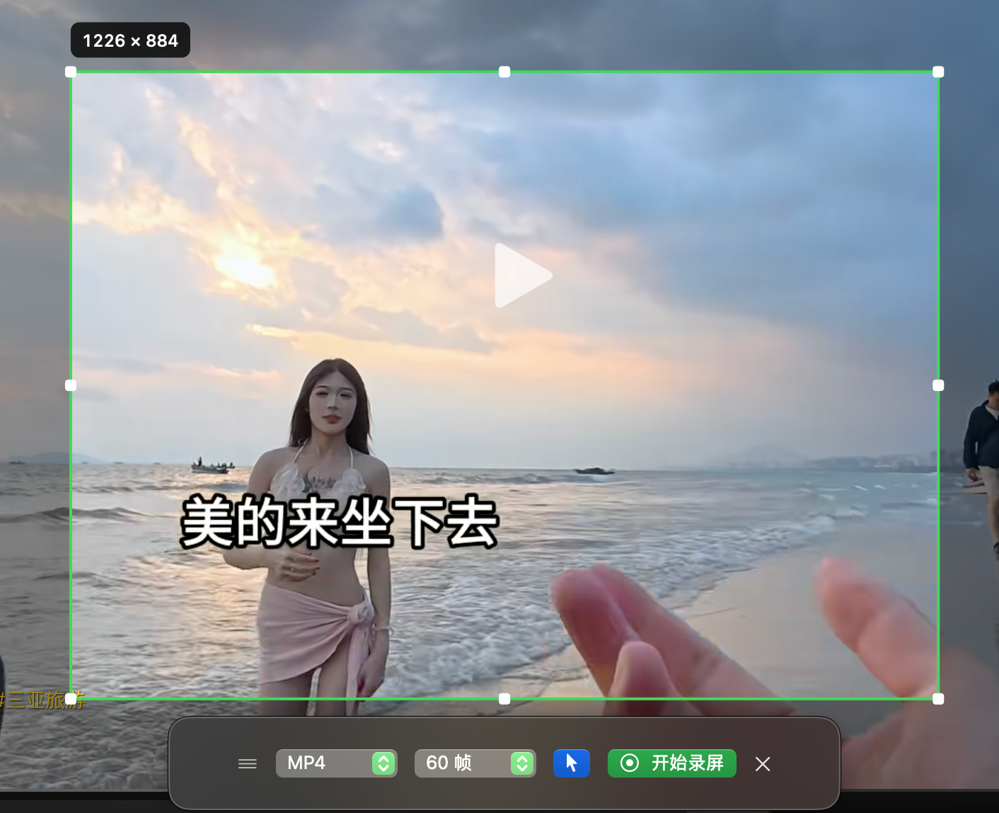
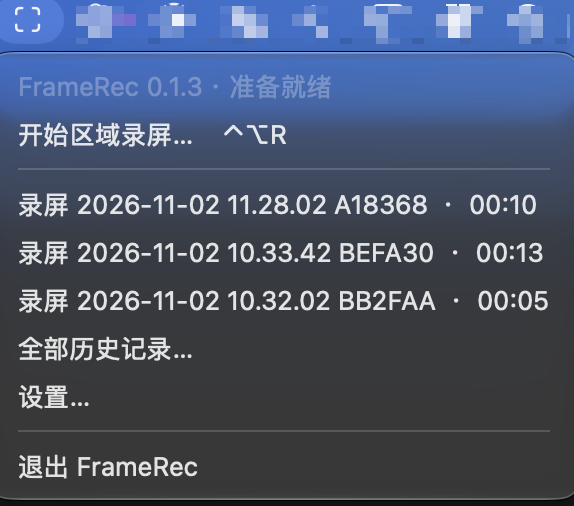
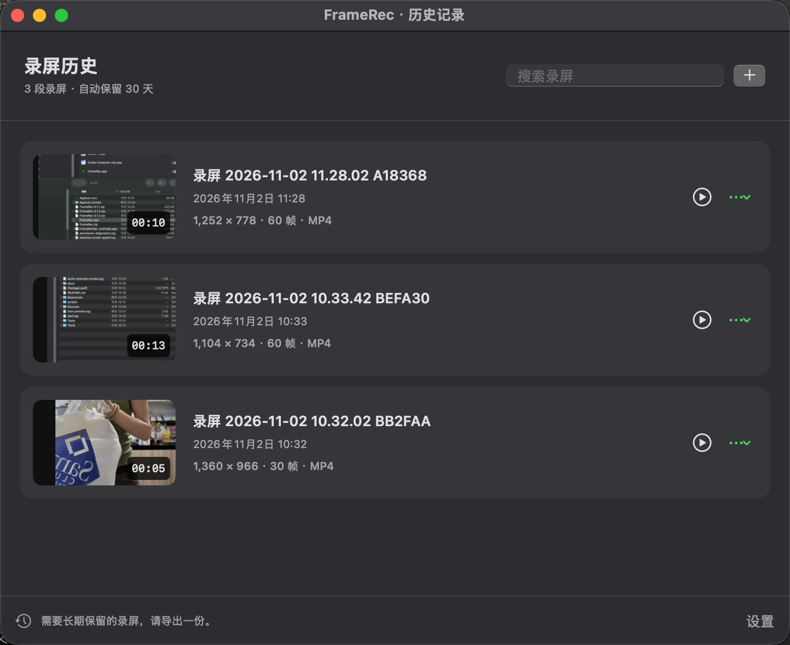
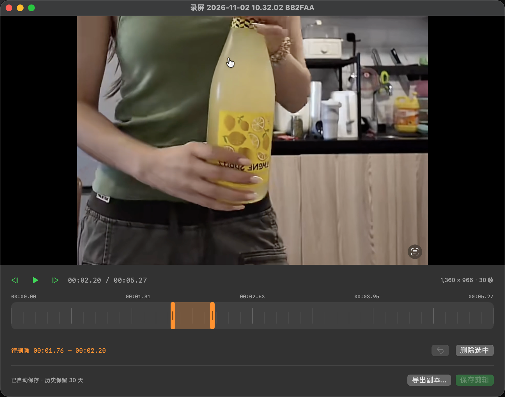

# FrameRec

[中文](README.md)


A macOS menu bar app for recording a selected screen region. Pause to skip unwanted content, then resume into the same video. FrameRec supports multiple displays, system audio, and removing sections after recording.

## App preview

### 1. Region recording

Drag to select a region, then adjust it with the edge handles. The green border marks the capture area, and the label shows its resolution. Use the floating toolbar to choose MP4 / MOV, frame rate, and cursor visibility before starting.



### 2. App features and menu bar access

The menu bar menu shows the app version and current status. Start a region recording, open recent recordings, browse the full history, or change settings. Global shortcuts also control recording.



### 3. Recording history

Browse thumbnails, names, dates, durations, resolutions, frame rates, and formats. Search recordings, preview them, rename them, or export a copy. History recordings are kept for 30 days; export a copy to keep a recording long term.



### 4. Preview and lightweight editing

Play a recording, step through frames, and drag across the timeline to select a section for deletion. The orange range marks the current selection. Deleting it joins the remaining video and audio; undo, save, and export are also available.



## Features

- **Region capture:** select, move, and resize a region before recording. Multiple displays are supported; each recording region stays within one display.
- **Pause and resume:** paused time is omitted from the output, and resumed content continues in the same video.
- **System audio:** records the computer's internal audio without requesting or using the microphone.
- **Recording options:** MP4 / MOV, 24 / 30 / 60 fps, and optional cursor capture.
- **Menu bar and shortcuts:** start, pause, stop, and access recent recordings; global shortcuts are customizable.
- **History management:** automatic saving, search, renaming, preview, copy export, and automatic cleanup after 30 days.
- **Lightweight editing:** delete timeline ranges, step through frames, undo edits, and remove matching audio sections.
- **Local processing:** native system frameworks, no third-party runtime dependencies, and no account or API key required.

## Requirements

The download requires **macOS 14 or later**. The universal app supports both Apple Silicon and Intel Macs, with no development tools needed. The app interface is currently in Chinese.

Building from source additionally requires:

- Xcode Command Line Tools or Xcode with Swift 6.0 or later. Install the command line tools with `xcode-select --install`.
- Python 3 for packaging and local signing scripts. The build also uses `openssl`, `codesign`, and `iconutil`.

The source uses Swift Package Manager with no external Swift package dependencies.

## Install and launch

### Download the app

Get the latest version from [GitHub Releases](https://github.com/xiuleitan/FrameRec/releases/latest).

1. Download `FrameRec-<version>-macOS-universal.dmg`, open it, and drag `FrameRec.app` to Applications.
2. Alternatively, extract the matching `.zip` and drag `FrameRec.app` to Applications. You do not need the `Source code` archives.
3. Open FrameRec from Applications and click the viewfinder icon in the menu bar. Quit an existing installation before updating.

The current release uses a persistent local signature and **has no Apple Developer ID signature or Apple notarization**. If macOS blocks the first launch, verify the download source, then follow [Apple's instructions](https://support.apple.com/en-us/102445): open System Settings > Privacy & Security, find the FrameRec notice, and choose Open Anyway. See the [installation instructions](docs/INSTALL.en.txt) for details.

### Build from source

```sh
git clone https://github.com/xiuleitan/FrameRec.git
cd FrameRec
./scripts/build.sh
open build/FrameRec.app
```

`build.sh` builds the release configuration by default. Use `./scripts/run.sh` to build and launch a debug version. The resulting app is at `build/FrameRec.app`; you can drag it to Applications. Open `Package.swift` in Xcode to work on the source.

On the first recording request, FrameRec checks and requests screen recording permission before opening the region selector. Follow the macOS prompt for Screen & System Audio Recording, then quit and reopen the app if needed. Settings also shows the permission state and offers a permission request button. The app does not request or use the microphone. Its viewfinder icon lives in the menu bar and opens recording, history, and settings controls.

Opening the app again while it is running brings up the history window. When a history or preview window is active, the application menu also provides access to history and settings.

## Configuration

Change common options in the app's Settings window:

| Setting | Default / available values |
| --- | --- |
| Recording format | MP4; MOV is also available |
| Frame rate | 30; choose 24 / 30 / 60 fps |
| Cursor capture | Enabled |
| Floating recording toolbar | Enabled |
| Save directory | `~/Movies/FrameRec`; customizable |
| History retention | Fixed at 30 days after recording completes |
| Global shortcuts | Customizable; defaults are listed below |
| Launch at login | Can be enabled in Settings; managed by macOS |

No `.env` file is needed to run the app. Build and test scripts support these optional environment variables:

| Variable | Purpose | When unset |
| --- | --- | --- |
| `FRAMEREC_SIGN_IDENTITY` | Use an existing code-signing identity, such as Developer ID | Use a persistent local signing certificate |
| `FRAMEREC_SIGNING_HOME` | Override the local signing material directory | `~/Library/Application Support/FrameRec/Signing` |
| `FRAMEREC_FIXTURE_PATH` | Copy a generated media-test video to a file path, replacing any existing file there | Remove temporary test videos without keeping another copy |

Keep signing material outside the repository. If you want to retain a test video, point `FRAMEREC_FIXTURE_PATH` to the ignored `build/` directory.

## Usage

| Action | Default shortcut |
| --- | --- |
| Select a new region | Control + Option + R |
| Pause / resume | Control + Option + P |
| Stop and save automatically | Control + Option + S |
| Cancel selection / confirm discarding a recording | Esc |

Shortcuts can be changed in Settings and do not require Accessibility permission.

1. Drag to select a region on any display. Before starting, move it by dragging inside or resize it with the handles. A single selection stays within one display.
2. Choose the format, frame rate, and cursor visibility in the toolbar outside the selection. Defaults are MP4, 30 fps, and cursor capture enabled.
3. Start recording. The region's position and size stay fixed during recording and pauses. You can pause, seek the source video, and resume recording the same area. Paused time is excluded from both the output and the timer.
4. Stop to save automatically. Click the save notification or a recent recording in the menu bar to preview, edit, or export it.

The toolbar first tries to fit below the selection, then above, to either side, or on another display. If no suitable position exists, it collapses into the menu bar, where recording controls remain available. ScreenCaptureKit excludes FrameRec's own windows from the capture.

## Lightweight editing

Click the timeline to seek, drag to select a section for deletion, and fine-tune it with the two handles. Delete the selection to join the remaining content and remove the matching audio. Multiple deletions and undo are supported.

- Space: play / pause.
- Delete: remove the selected section.
- Command + Z: undo an edit.
- Command + S: save edits.
- Previous / next frame buttons: position the playhead one frame at a time.

Edits are previewed in memory first. Saving creates a temporary video and replaces the history video only after export succeeds; a failure preserves the original file. Editing does not reset the recording's original retention date. Closing an editor with unsaved changes prompts you to save or discard them.

## Files and history cleanup

The default history directory is `~/Movies/FrameRec` and can be changed in Settings. **Registered recordings in history are automatically deleted 30 days after recording completes.** Cleanup runs at launch and hourly while the app is running. If the app is closed, cleanup resumes at the next launch. Videos currently open for preview or editing are temporarily protected.

Use Export Copy to keep a recording long term. Exported copies are not registered in history and are not automatically cleaned up. Cleanup only processes files listed in `.framerec-history.json`; it does not scan and delete other videos in the directory. Changing the save directory keeps the old history accessible and subject to its existing retention dates. Disconnected external storage is processed after it is reconnected and the app launches again.

The hidden `.framerec-staging` directory holds temporary recording and editing files. If saving fails, the app shows the temporary file path for recovery. Failed temporary recordings are not treated as successfully saved history entries for cleanup.

## Development and verification

```sh
./scripts/test.sh
./scripts/build.sh release
```

Tests cover coordinate conversion across displays, toolbar placement, pause timing, time mapping after repeated deletions, history cleanup boundaries, and file replacement. Real H.264 / AAC files are used to check output duration after pauses, audio tracks, and frame order after removing a middle section.

Screen permissions, protected video content, different display arrangements, and actual system audio capture still need recording checks on the target Mac. Start with an ordinary webpage or local video for a trial recording.

The build script reuses a persistent local signing certificate stored at `~/Library/Application Support/FrameRec/Signing` so app updates retain the same privacy-permission identity. Private keys live in a dedicated encrypted keychain, which is locked after signing. Keep this private material on your Mac or in a secure backup, outside the repository. The keychain is not added to the system trust store or the default keychain search list.

When migrating from version 0.1.2 or an earlier ad-hoc-signed build, remove the old FrameRec entry from Screen & System Audio Recording once, add the new `FrameRec.app`, then fully quit and reopen the app. Subsequent local builds reuse the same certificate. Run `python3 scripts/check-signing.py` to verify that different builds retain the same signing identity while a different signature is rejected.

If you have a Developer ID, set `FRAMEREC_SIGN_IDENTITY` to choose that identity. Signing and notarization for distribution to other Macs require separate configuration.

### Package a release

```sh
./scripts/package-release.sh
```

The script builds a universal arm64 / x86_64 app and creates a DMG, ZIP, and `SHA256SUMS.txt` in `build/releases/v<version>/`. The DMG includes an Applications shortcut, Chinese and English installation notes, and the license. The ZIP contains `FrameRec.app`. Packaging checks both architectures, the app signature, and the signature after extracting the ZIP. Existing output for the same version is preserved and causes the script to stop.

To build only the universal app, run `./scripts/build.sh release universal`; output is at `build/universal/FrameRec.app`. Omitting the second argument keeps building for the current Mac at `build/FrameRec.app`. A local signature is separate from Developer ID signing and Apple notarization.

Existing validation scope and fixes are documented in the [validation notes](docs/VALIDATION.md), [0.1.1 selection fix](docs/FIX-0.1.1.md), and [0.1.3 permission fix](docs/FIX-0.1.3.md). These notes are in Chinese.

## Source layout

- `Sources/FrameRec`: menu bar, shortcuts, recording toolbar, settings, history, preview, and editing UI.
- `Sources/FrameRecCore`: media writing, pause timing, editing composition, history storage, and geometry.
- `Sources/FrameRecUI`: native region selection, screen borders, and testable permission checks.
- `Tests/FrameRecCoreTests`: data safety, timeline, and real-media tests.
- `Tests/FrameRecUITests`: selection mouse events, cursor bounds, and permission regression tests.
- `scripts`: app packaging, signing, and icon generation.

Run `./scripts/build-selection-probe.sh` and open `build/FrameRecSelectionProbe.app` to check real mouse selection and toolbar placement separately. The probe does not capture the screen or request recording permission. It writes results to `build/selection-probe.json`; press Esc to exit. It is not included in the production app.

## Privacy and local files

Recording and editing run locally using native macOS frameworks. The app requires no account and contains no recording upload or telemetry feature. It captures system audio without using the microphone. Screen recording access is granted by the user in macOS System Settings.

The repository ignores Swift build caches (`.build/`, `.swiftpm/`), app bundles and other build output (`build/`), logs, environment files, and private signing material. Root-level `recordings/` and `exports/` directories, `.framerec-history.json` indexes, and `.framerec-staging/` temporary directories are also excluded. The four app screenshots are stored in `docs/images/`.

## License

This project is licensed under the [MIT License](LICENSE).

Usage notice: the project is intended for personal, non-commercial use only. This notice does not add restrictions to the MIT License; the license text defines the granted rights.
