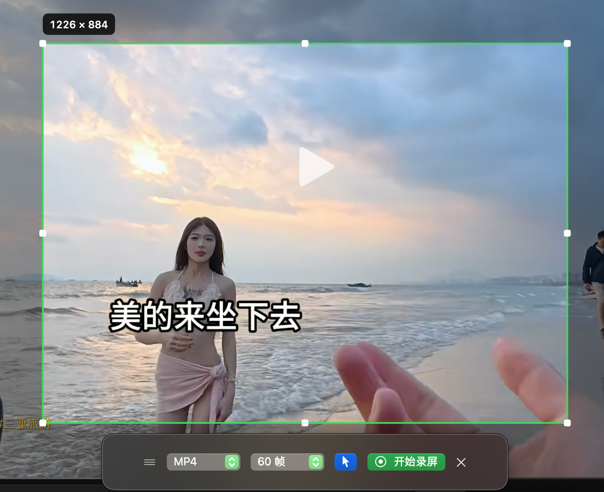
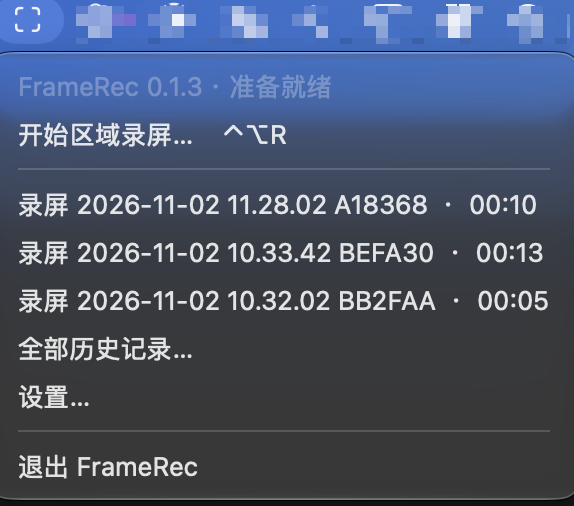
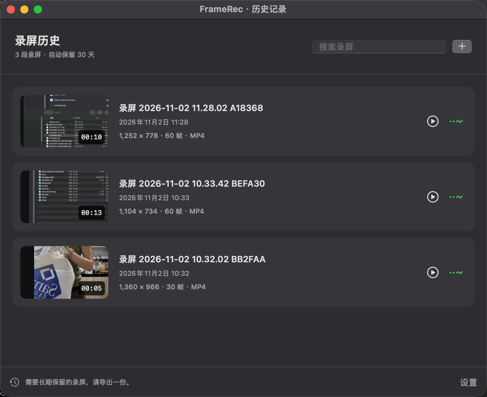
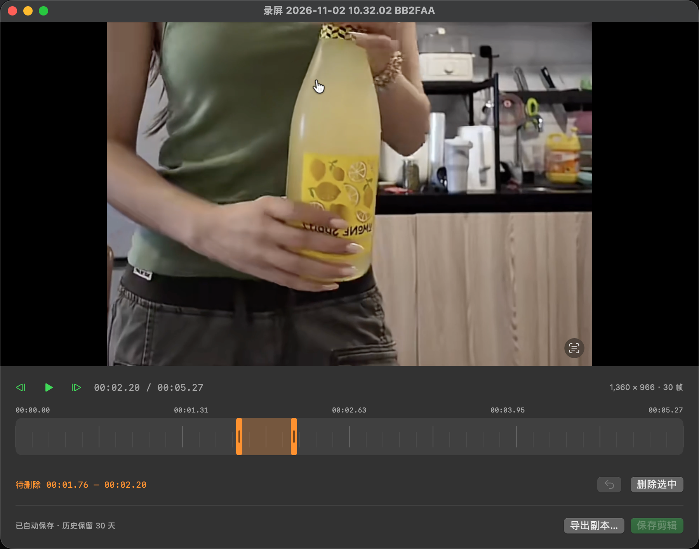

# FrameRec

[English](README.en.md)


一个常驻 macOS 菜单栏的区域录屏工具。框选区域后开始录制，暂停时跳过不需要的内容，继续后接在同一个视频里。支持多显示器、电脑内部声音，以及录制后的区间删除。

## 应用预览

### 1. 区域录屏

拖动框选要录制的画面，再通过边缘手柄调整范围。绿色边框标明录制区域，左上角显示分辨率；下方悬浮条可选择 MP4 / MOV、帧率和是否显示鼠标指针，然后开始录屏。



### 2. 应用功能与菜单栏入口

FrameRec 常驻菜单栏，顶部显示版本和当前状态。从这里可以开始区域录屏、打开最近录屏、进入全部历史记录或修改设置；录制操作也可以通过全局快捷键完成。



### 3. 录屏历史

历史窗口集中显示录屏缩略图、名称、日期、时长、分辨率、帧率和格式，支持搜索、预览、重命名及导出副本。历史录屏自动保留 30 天，需要长期保存的内容请导出一份。



### 4. 预览与轻量剪辑

在同一个窗口中播放、逐帧定位并拖选待删除的时间段。橙色区间表示当前选中的片段；删除后剩余画面与声音自动衔接，支持撤销、保存剪辑和导出副本。



## 功能

- **区域录屏**：支持多显示器，可在开始前移动和缩放选区；单次选区限定在一块屏幕。
- **暂停续录**：暂停时间不进入成片，继续录制后自动接在同一个视频里。
- **系统声音**：录制电脑内部声音，不请求或使用麦克风。
- **录制参数**：支持 MP4 / MOV、24 / 30 / 60 帧，可控制鼠标指针显示。
- **菜单栏与快捷键**：快速启动录制、暂停、结束和访问最近录屏，快捷键可自定义。
- **历史管理**：自动保存、搜索、重命名、预览、导出副本及 30 天自动清理。
- **轻量剪辑**：时间轴区间删除、逐帧定位、撤销，以及画面与声音同步剪除。
- **本地处理**：使用系统原生框架，无第三方运行依赖，无需账号或 API 密钥。

## 环境要求

下载版需要 **macOS 14 或更高版本**。通用版同时支持 Apple 芯片和 Intel Mac，无需安装开发工具。应用界面目前为中文。

从源码构建时还需要：

- 支持 Swift 6.0 或更高版本的 Xcode Command Line Tools 或 Xcode；可通过 `xcode-select --install` 安装命令行工具。
- Python 3，用于应用打包和本地签名脚本；构建还会调用系统的 `openssl`、`codesign` 和 `iconutil`。

源码使用 Swift Package Manager 管理，没有外部 Swift 包依赖。

## 安装与启动

### 直接下载安装

前往 [GitHub Releases 下载最新版本](https://github.com/xiuleitan/FrameRec/releases/latest)。

1. 推荐下载 `FrameRec-<版本>-macOS-universal.dmg`，打开后将 `FrameRec.app` 拖到“应用程序”。
2. 也可以下载同名 `.zip`，解压后将 `FrameRec.app` 拖到“应用程序”。无需下载 `Source code` 源码包。
3. 从“应用程序”打开 FrameRec，再点击菜单栏右侧的取景框图标使用。更新时请先退出旧版。

当前发布使用固定的本地签名，**尚未使用 Apple Developer ID 签名或经过 Apple 公证**。如果首次打开被 macOS 拦截，请在确认下载来源后，按照 [Apple 官方说明](https://support.apple.com/zh-cn/102445)前往“系统设置 → 隐私与安全性”，找到 FrameRec 提示并选择“仍要打开”。具体步骤见 [安装说明](docs/INSTALL.zh-CN.txt)。

### 从源码构建

```sh
git clone https://github.com/xiuleitan/FrameRec.git
cd FrameRec
./scripts/build.sh
open build/FrameRec.app
```

`build.sh` 默认构建 release 版本。也可以使用 `./scripts/run.sh` 构建并启动调试版本。生成的应用位于 `build/FrameRec.app`，可以拖到“应用程序”中使用，也可以在 Xcode 中打开 `Package.swift` 开发。

第一次点击“开始区域录屏”或按框选快捷键时，会先检查并申请录屏权限，再进入框选。按系统提示授权“屏幕与系统音频录制”；必要时退出并重新打开应用。设置窗口也提供录屏权限状态和“检查并申请录屏权限”按钮。FrameRec 不请求或使用麦克风。应用平时在菜单栏右侧显示取景框图标，点击图标可打开录制、历史和设置菜单。

再次打开已运行的应用会显示历史窗口。预览或历史窗口激活时，也可通过应用菜单进入“录屏历史”和“设置”。

## 配置项

常用设置在应用的“设置”窗口中修改：

| 配置 | 默认值 / 可选值 |
| --- | --- |
| 录制格式 | MP4；可选 MOV |
| 帧率 | 30；可选 24 / 30 / 60 帧 |
| 鼠标指针 | 显示 |
| 录制悬浮条 | 显示 |
| 自动保存目录 | `~/Movies/FrameRec`，可修改 |
| 历史保留时间 | 固定为录制完成后 30 天 |
| 全局快捷键 | 可自定义，默认组合见下表 |
| 登录时启动 | 可在设置中开启，由 macOS 管理 |

应用运行不需要 `.env` 文件。构建和测试提供以下可选环境变量：

| 环境变量 | 用途 | 未设置时 |
| --- | --- | --- |
| `FRAMEREC_SIGN_IDENTITY` | 指定已有的代码签名身份，例如 Developer ID | 使用固定的本地签名证书 |
| `FRAMEREC_SIGNING_HOME` | 自定义本地签名材料目录 | `~/Library/Application Support/FrameRec/Signing` |
| `FRAMEREC_FIXTURE_PATH` | 将媒体测试生成的示例视频复制到指定文件路径，已有同名文件会被覆盖 | 测试结束后清理临时视频，不额外保留副本 |

签名材料目录应放在仓库之外。需要保留测试视频时，建议将 `FRAMEREC_FIXTURE_PATH` 指向已忽略的 `build/` 目录。

## 使用方法

| 操作 | 默认快捷键 |
| --- | --- |
| 框选新区域 | Control + Option + R |
| 暂停 / 继续 | Control + Option + P |
| 结束并自动保存 | Control + Option + S |
| 取消框选 / 确认放弃录制 | Esc |

快捷键可在设置中修改，不依赖辅助功能权限。

1. 在任意显示器上拖动框选。开始前可拖动区域内部或四周手柄调整选区，单次选区限定在一块屏幕。
2. 选区外的悬浮条提供格式（MP4 / MOV）、帧率（24 / 30 / 60）和鼠标指针设置，默认 MP4、30 帧、显示指针。
3. 点击开始。录制期间、暂停期间，区域的位置和大小均固定。暂停时可以拖动网页视频的播放进度，恢复后继续录制同一区域。暂停时间不会进入成片或计时。
4. 点击结束，自动保存。点击保存提示或菜单栏历史记录可预览、剪辑或导出。

悬浮条优先置于选区下方，空间不足时依次尝试上方、左右和其他显示器。没有合适位置时收起到菜单栏，仍可从菜单开始或控制录制。应用自身的窗口通过 ScreenCaptureKit 过滤，不进入录屏画面。

## 轻量剪辑

预览窗口下方的时间轴支持点击定位、拖动选择待删除区间，以及通过两端手柄微调范围。点击“删除选中”后，剩余内容自动衔接，声音同步剪除。支持多次删除和撤销。

- 空格：播放 / 暂停。
- Delete：删除所选时间段。
- Command + Z：撤销剪辑。
- Command + S：保存剪辑。
- “上一帧 / 下一帧”可逐帧定位。

修改先在内存中预览。保存时生成临时视频，成功后替换历史视频；保存失败保留原文件。剪辑不改变录屏最初的保存时间。关闭尚未保存的剪辑会提示保存或放弃。

## 文件和历史清理

默认历史目录为 `~/Movies/FrameRec`，可在设置中修改。**该目录中的已登记录屏文件在录制完成 30 天后会自动删除。** 清理在应用启动时和运行期间每小时进行；应用未运行时，在下次启动补做。正在预览或剪辑的视频暂缓清理。

需要长期保留的录屏，请使用“导出副本”。导出的文件不登记到历史，不会被自动清理。清理只处理 `.framerec-history.json` 登记的文件，不扫描删除同目录内其他视频。切换保存目录后，旧目录中的历史仍可访问并继续按期清理；未连接的外接存储在重新连接并启动应用后处理。

隐藏目录 `.framerec-staging` 用于录制和剪辑的临时文件。保存异常时会显示临时文件路径，方便恢复；不会把异常临时文件当作成功录屏删除。

## 开发与验证

```sh
./scripts/test.sh
./scripts/build.sh release
```

测试覆盖多屏坐标转换、悬浮条避让、暂停时间对齐、重复删除后的时间映射、历史删除边界和文件替换，并使用真实 H.264 / AAC 文件验证暂停后成片时长、音频轨道以及删除中段后的画面顺序。

屏幕权限、受保护的视频内容、不同显示器布局和系统声音采集仍需在目标 Mac 上实际录制验证。首次试录建议使用一个普通网页或本地视频。

构建脚本默认复用固定的本地签名证书，身份保存在 `~/Library/Application Support/FrameRec/Signing`，以便应用更新后仍满足同一隐私授权身份。密钥保存在专用加密钥匙串中，构建完成后会锁定；这个目录包含私密的签名材料，应保留在本机或安全备份中，不要提交到仓库。它不加入系统信任库或默认钥匙串搜索列表。

从 0.1.2 或更早的临时签名版本迁移时，需要一次性在“录屏与系统录音”中移除旧的 FrameRec 项，再添加新的 `FrameRec.app`，然后完全退出并重新打开。之后的本地构建会复用同一个证书。可以运行 `python3 scripts/check-signing.py` 验证不同构建身份一致，同时拒绝不同签名。

若有 Developer ID，可通过 `FRAMEREC_SIGN_IDENTITY` 指定签名身份。分发到其他 Mac 的签名与公证需要单独配置。

### 制作发布包

```sh
./scripts/package-release.sh
```

脚本构建 arm64 / x86_64 通用版，并在 `build/releases/v<版本>/` 生成 DMG、ZIP 和 `SHA256SUMS.txt`。DMG 内附“应用程序”快捷入口、中英文安装说明及许可证；ZIP 内为 `FrameRec.app`。打包时会验证两个架构、应用签名和 ZIP 解压后的签名，已有同版本输出会被保留并停止覆盖。

单独构建通用应用可运行 `./scripts/build.sh release universal`，产物为 `build/universal/FrameRec.app`。未指定第二个参数时仍构建当前 Mac 架构，产物为 `build/FrameRec.app`。本地签名不等同于 Developer ID 签名或 Apple 公证。

更详细的已有验证范围和版本修复记录见 [验证记录](docs/VALIDATION.md)、[0.1.1 框选修复](docs/FIX-0.1.1.md) 和 [0.1.3 授权修复](docs/FIX-0.1.3.md)。

## 源码结构

- `Sources/FrameRec`：菜单栏、快捷键、多屏框选、悬浮条、设置、历史和预览剪辑界面。
- `Sources/FrameRecCore`：音视频写入、暂停时间映射、剪辑合成、历史库和几何计算。
- `Sources/FrameRecUI`：原生区域框选、屏幕边框和可测试的授权检查。
- `Tests/FrameRecCoreTests`：数据安全、时间轴和真实媒体测试。
- `Tests/FrameRecUITests`：框选鼠标事件、光标区域边界和授权状态回归测试。
- `scripts`：应用打包和图标生成。

开发时可运行 `./scripts/build-selection-probe.sh`，打开生成的 `build/FrameRecSelectionProbe.app`，单独检查真实鼠标框选和控制条避让。该检查工具不采集屏幕、不申请录屏权限，结果写入 `build/selection-probe.json`；按 Esc 退出。它不会打包进正式应用。

## 隐私与本地文件

录屏和剪辑使用 macOS 原生框架在本地完成。应用无需账号，不包含录屏上传或遥测功能；录制电脑内部声音，不采集麦克风。录屏权限由用户在 macOS 系统设置中授予。

仓库忽略 Swift 构建缓存（`.build/`、`.swiftpm/`）、应用包及其他构建产物（`build/`）、日志、环境文件和私密签名材料。仓库根目录下的 `recordings/`、`exports/`，以及历史索引 `.framerec-history.json`、临时目录 `.framerec-staging/` 也不会提交。用于展示应用的四张截图保存在 `docs/images/` 中。

## 许可证

本项目采用 [MIT License](LICENSE)。

用途说明：项目预期仅用于个人、非商业场景。这是用途说明，不构成 MIT 许可证的附加限制，具体授权范围以许可证文本为准。
